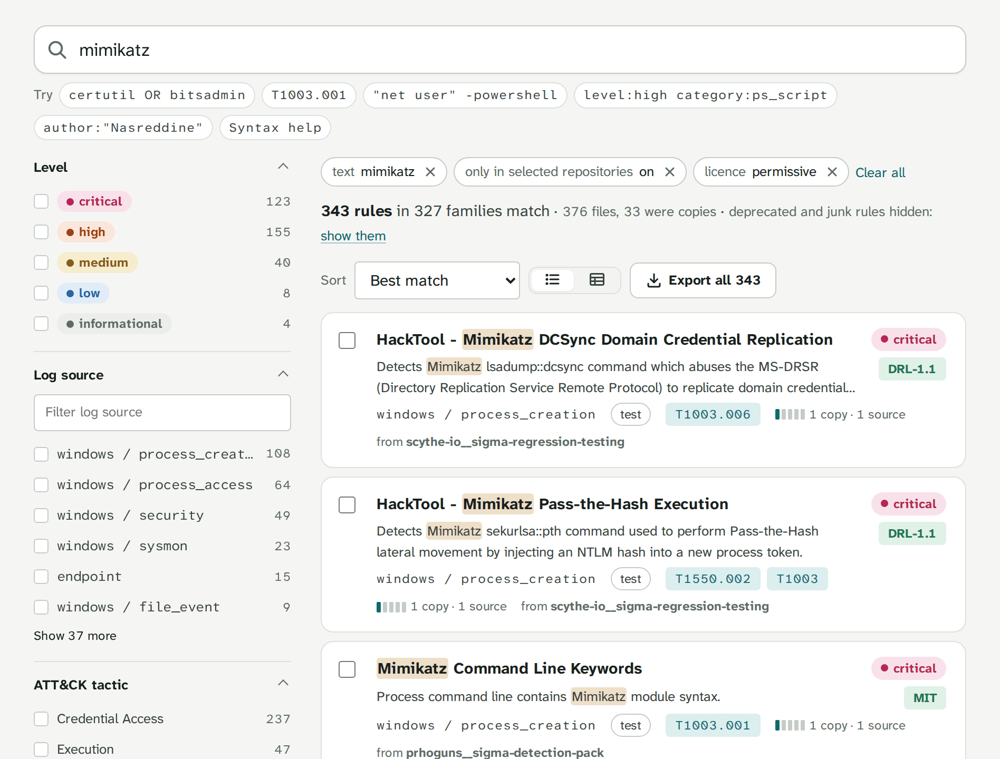
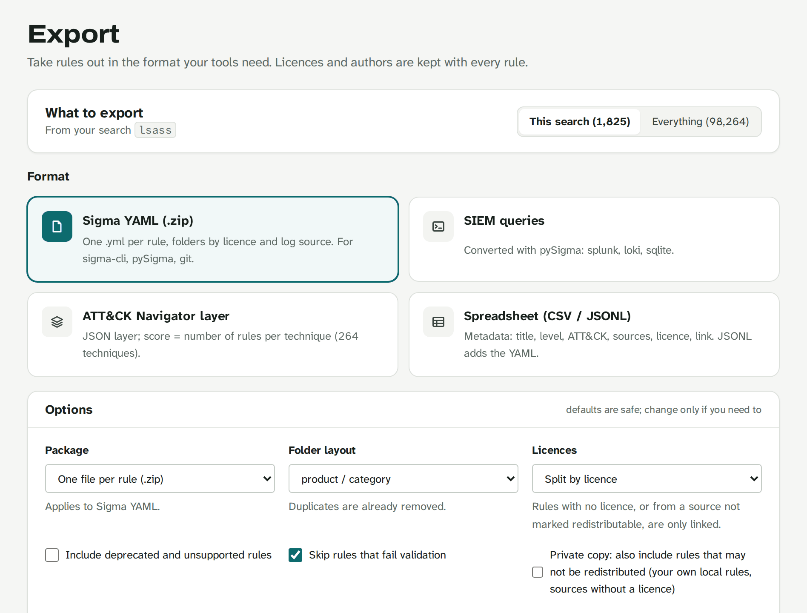
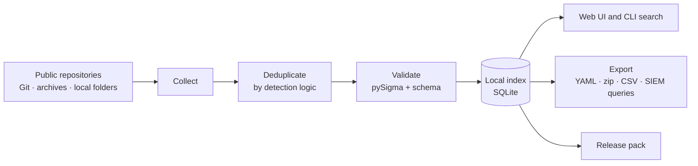

<p align="center">
  
</p>

<h1 align="center">sigharvest</h1>

<p align="center">
  <b>Every public Sigma rule, in one place, without the duplicates.</b><br>
  Collect · deduplicate · validate · search · export, on your own machine.
</p>

<p align="center">
  <a href="https://github.com/threat-hunter-eu/sigharvest/actions/workflows/ci.yml"></a>
  <a href="https://github.com/threat-hunter-eu/sigharvest/blob/main/LICENSE"></a>
  
</p>

<p align="center">
  <a href="https://threat-hunting.eu/tools/sigharvest">Website</a> ·
  <a href="#quickstart">Quickstart</a> ·
  <a href="#what-you-get">What you get</a> ·
  <a href="#how-it-works">How it works</a> ·
  <a href="#download-the-rules">Download the rules</a> ·
  <a href="#documentation">Docs</a>
</p>

<picture>
  <source media="(prefers-color-scheme: dark)" srcset="docs/screenshots/overview-dark.png">
  
</picture>

Public Sigma rules are spread over more than a thousand repositories, and most of them are copies, forks or renames
of each other. sigharvest collects them, keeps **one entry per detection logic** with every copy and its licence,
checks each rule with pySigma, and gives you a fast local search and one-command exports, including ready SIEM
queries. It works offline after the first update and never sends your data anywhere.

## Quickstart

You need Python 3.12+, Git and [uv](https://docs.astral.sh/uv/).

<!-- doctest -->
```bash
uv tool install "sigharvest[convert] @ git+https://github.com/threat-hunter-eu/sigharvest"
sigharvest init ~/sigma && cd ~/sigma && sigharvest update   # first run: about 10 minutes
sigharvest serve                                             # http://127.0.0.1:8799
```

Or stay in the terminal:

<!-- doctest -->
```bash
sigharvest search mimikatz
sigharvest export lsass --product windows --format splunk --out lsass.spl
```

`init` starts with a curated set of 26 sources with original content; `sigharvest init ~/sigma --from-release latest`
starts from the full nightly corpus instead. Elastic, OpenSearch or Microsoft 365 Defender queries need the
`[convert-legacy]` extra ([which extra for which SIEM](https://github.com/threat-hunter-eu/sigharvest/blob/main/docs/export.md#which-extra-for-which-siem)). Step by step: [Getting started](https://github.com/threat-hunter-eu/sigharvest/blob/main/docs/getting-started.md).

## What you get

<details open>
<summary><b>Search</b>: full-text queries and filters (level, log source, ATT&CK, source, licence, validation).</summary>

<picture>
  <source media="(prefers-color-scheme: dark)" srcset="docs/screenshots/search-dark.png">
  
</picture>

</details>

<details open>
<summary><b>Rule pages</b>: what the rule detects in plain words, the YAML, every copy and its licence.</summary>

<picture>
  <source media="(prefers-color-scheme: dark)" srcset="docs/screenshots/rule-dark.png">
  
</picture>

</details>

<details>
<summary><b>Export</b>: Sigma YAML, SIEM queries, Navigator layer or CSV, with a <code>NOTICE.md</code> per licence.</summary>

<picture>
  <source media="(prefers-color-scheme: dark)" srcset="docs/screenshots/export-dark.png">
  
</picture>

</details>

<details>
<summary><b>ATT&amp;CK coverage</b>: the technique matrix with rule counts per cell, filters and a Navigator layer.</summary>

<picture>
  <source media="(prefers-color-scheme: dark)" srcset="docs/screenshots/coverage-dark.png">
  
</picture>

</details>

- **Deduplicated by logic**, not by file name: renamed copies are one rule, variants form a family.
- **Validated** with pySigma and the Sigma schema; junk and broken YAML are set aside.
- **SIEM queries** for Splunk, Loki, SQLite, Elastic, OpenSearch and Defender via pySigma.
- **ATT&CK coverage**, gaps and a Navigator layer from the rule tags.
- **Licence-aware**: every rule keeps its source, author and licence.
- **Lint your own rules** against the public corpus, with SARIF and a GitHub Action.
- **Local and private**: the web UI binds to 127.0.0.1 and loads nothing from the internet.

## How it works



Updates are incremental: only changed sources are fetched, and a source that fails keeps its last good copy.
[Concepts](https://github.com/threat-hunter-eu/sigharvest/blob/main/docs/concepts.md) and the [rule identity specification](https://github.com/threat-hunter-eu/sigharvest/blob/main/docs/identity.md) explain the details.

## Download the rules

Don't want to install anything? The **sigharvest-rules** nightly pack has the whole public corpus (about 1,200
sources), deduplicated, validated and split by licence: a permissive zip, a copyleft zip, metadata for every rule
and an ATT&CK Navigator layer. The first pack (`rules-2026-11-17`) lists 98,733 rules from 1,165 sources; 66,986
of them (permissive or copyleft) ship with their YAML, the others as metadata and a link to the original.

**[Latest sigharvest-rules release](https://github.com/threat-hunter-eu/sigharvest-rules/releases/latest)** (the
first pack is published at launch; until then the link shows no release).

<!-- doctest: skip network (downloads a release) -->
```bash
curl -LO https://github.com/threat-hunter-eu/sigharvest-rules/releases/latest/download/sigharvest-rules-permissive.zip
```

Rules without a licence that allows redistribution are listed with a link only. Every file in the pack:
[docs/releases.md](https://github.com/threat-hunter-eu/sigharvest/blob/main/docs/releases.md).

## Documentation

| | |
|---|---|
| **Start** | [Getting started](https://github.com/threat-hunter-eu/sigharvest/blob/main/docs/getting-started.md) · [CLI recipes](https://github.com/threat-hunter-eu/sigharvest/blob/main/docs/cli.md) · [Web UI](https://github.com/threat-hunter-eu/sigharvest/blob/main/docs/web.md) · [FAQ](https://github.com/threat-hunter-eu/sigharvest/blob/main/docs/faq.md) |
| **Rules** | [Export and SIEM queries](https://github.com/threat-hunter-eu/sigharvest/blob/main/docs/export.md) · [Sources and licences](https://github.com/threat-hunter-eu/sigharvest/blob/main/docs/sources.md) · [Concepts](https://github.com/threat-hunter-eu/sigharvest/blob/main/docs/concepts.md) |
| **Run it** | [Releases](https://github.com/threat-hunter-eu/sigharvest/blob/main/docs/releases.md) · [Unattended updates](https://github.com/threat-hunter-eu/sigharvest/blob/main/docs/scheduling.md) · [GitHub Actions](https://github.com/threat-hunter-eu/sigharvest/blob/main/docs/automation.md) · [Architecture](https://github.com/threat-hunter-eu/sigharvest/blob/main/docs/architecture.md) |

Contributions are welcome: see [CONTRIBUTING.md](https://github.com/threat-hunter-eu/sigharvest/blob/main/CONTRIBUTING.md). Security reports: [SECURITY.md](https://github.com/threat-hunter-eu/sigharvest/blob/main/SECURITY.md).

## Maintainers

- [@angstromissa](https://github.com/angstromissa)
- [@elhoim](https://github.com/elhoim)

## Licence and attribution

sigharvest is released under the [MIT licence](https://github.com/threat-hunter-eu/sigharvest/blob/main/LICENSE). It never changes the licence of a rule: every rule keeps
its source, author and licence, and every export carries a `NOTICE.md` ([rule licences](https://github.com/threat-hunter-eu/sigharvest/blob/main/docs/sources.md#licences)). Built on
[Sigma](https://github.com/SigmaHQ/sigma) and [pySigma](https://github.com/SigmaHQ/pySigma). Full details:
[NOTICE](https://github.com/threat-hunter-eu/sigharvest/blob/main/NOTICE).

Not affiliated with or endorsed by SigmaHQ, OISF, Proofpoint/Emerging Threats or MITRE. MITRE ATT&CK® and ATT&CK®
are registered trademarks of The MITRE Corporation; ATT&CK data: © 2026 The MITRE Corporation. This work is
reproduced and distributed with the permission of The MITRE Corporation
([terms of use](https://attack.mitre.org/resources/legal-and-branding/terms-of-use/)).

The published packs and site name rule authors and the GitHub owners of source repositories as their own
publications state them, for attribution. To have a rule corrected, attributed differently or removed,
[open an issue](https://github.com/threat-hunter-eu/sigharvest/issues) or write to
security@threat-hunting.eu.
