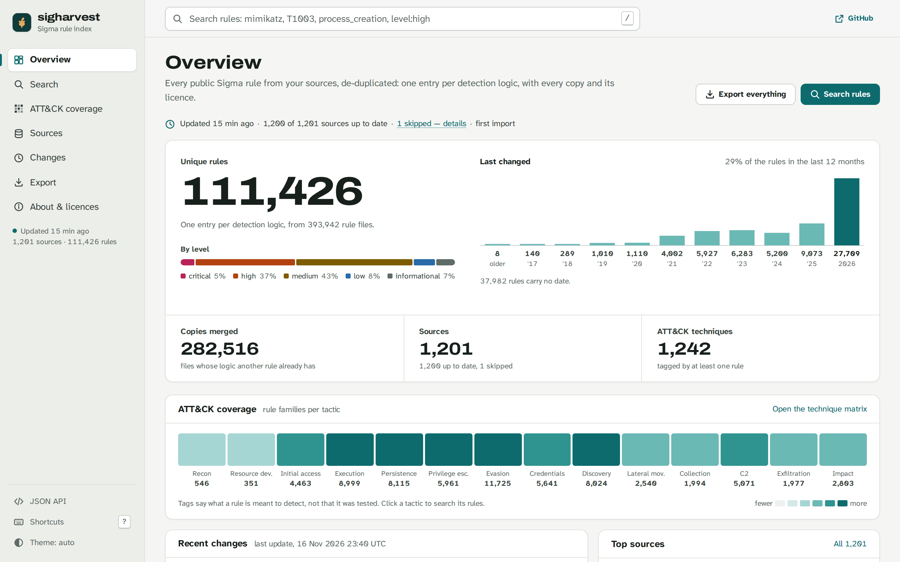

<p align="center">
  
</p>

<h1 align="center">sigharvest</h1>

<p align="center">
  <b>Every public Sigma rule, in one place, without the duplicates.</b><br>
  Collect · deduplicate · validate · search · export, on your own machine.
</p>

<p align="center">
  <a href="https://github.com/threat-hunter-eu/sigharvest/actions/workflows/ci.yml"></a>
  <a href="https://github.com/threat-hunter-eu/sigharvest/blob/main/LICENSE"></a>
  
</p>

<p align="center">
  <a href="https://threat-hunting.eu/tools/sigharvest">Website</a> ·
  <a href="#quickstart">Quickstart</a> ·
  <a href="https://github.com/threat-hunter-eu/sigharvest/blob/main/docs/features.md">Features</a> ·
  <a href="#download-the-rules">Download the rules</a> ·
  <a href="#documentation">Docs</a>
</p>

<picture>
  <source media="(prefers-color-scheme: dark)" srcset="docs/screenshots/overview-dark.png">
  
</picture>

Public Sigma rules are spread over more than a thousand repositories, and most of them are copies of each other.
sigharvest keeps **one entry per detection logic** with every copy and its licence, checks each rule with pySigma,
and gives you a fast local search and one-command exports, including ready SIEM queries. Offline after the first
update; your data never leaves the machine.

## Quickstart

You need Python 3.12+, Git and [uv](https://docs.astral.sh/uv/).

<!-- doctest -->
```bash
uv tool install "sigharvest[convert] @ git+https://github.com/threat-hunter-eu/sigharvest"
sigharvest init ~/sigma && cd ~/sigma && sigharvest update   # first run: about 10 minutes
sigharvest serve                                             # http://127.0.0.1:8799
```

Prefer the terminal: `sigharvest search mimikatz`, `sigharvest export lsass --format splunk --out lsass.spl`.
Step by step, other SIEMs and the full nightly corpus: [Getting started](https://github.com/threat-hunter-eu/sigharvest/blob/main/docs/getting-started.md).

## Highlights

- **Deduplicated by logic**, not by file name: renamed copies are one rule, variants form a family.
- **Validated** with pySigma and the Sigma schema; junk and broken YAML are set aside.
- **SIEM queries** for Splunk, Loki, SQLite, Elastic, OpenSearch and Defender via pySigma.
- **ATT&CK coverage**, gaps and a Navigator layer from the rule tags.
- **Licence-aware**: every rule keeps its source, author and licence; every export carries a `NOTICE.md`.
- **Local and private**: the web UI binds to 127.0.0.1 and loads nothing from the internet.

Screenshots of search, rule pages, export and coverage, and how the pipeline works: [Features](https://github.com/threat-hunter-eu/sigharvest/blob/main/docs/features.md).

## Download the rules

No install needed: the **[sigharvest-rules](https://github.com/threat-hunter-eu/sigharvest-rules/releases/latest)**
nightly pack has the whole public corpus (about 1,200 sources), deduplicated, validated and split by licence. The
first pack (`rules-2026-11-17`) lists 98,733 rules; 66,986 ship with their YAML. Every file: [Releases](https://github.com/threat-hunter-eu/sigharvest/blob/main/docs/releases.md).

<!-- doctest: skip network (downloads a release) -->
```bash
curl -LO https://github.com/threat-hunter-eu/sigharvest-rules/releases/latest/download/sigharvest-rules-permissive.zip
```

## Documentation

| | |
|---|---|
| **Start** | [Getting started](https://github.com/threat-hunter-eu/sigharvest/blob/main/docs/getting-started.md) · [Features](https://github.com/threat-hunter-eu/sigharvest/blob/main/docs/features.md) · [CLI recipes](https://github.com/threat-hunter-eu/sigharvest/blob/main/docs/cli.md) · [Web UI](https://github.com/threat-hunter-eu/sigharvest/blob/main/docs/web.md) · [FAQ](https://github.com/threat-hunter-eu/sigharvest/blob/main/docs/faq.md) |
| **Rules** | [Export and SIEM queries](https://github.com/threat-hunter-eu/sigharvest/blob/main/docs/export.md) · [Sources and licences](https://github.com/threat-hunter-eu/sigharvest/blob/main/docs/sources.md) · [Concepts](https://github.com/threat-hunter-eu/sigharvest/blob/main/docs/concepts.md) |
| **Run it** | [Releases](https://github.com/threat-hunter-eu/sigharvest/blob/main/docs/releases.md) · [Unattended updates](https://github.com/threat-hunter-eu/sigharvest/blob/main/docs/scheduling.md) · [GitHub Actions](https://github.com/threat-hunter-eu/sigharvest/blob/main/docs/automation.md) · [Architecture](https://github.com/threat-hunter-eu/sigharvest/blob/main/docs/architecture.md) |

## Contributing

Contributions are welcome: see [CONTRIBUTING](https://github.com/threat-hunter-eu/sigharvest/blob/main/.github/CONTRIBUTING.md); security reports: [SECURITY](https://github.com/threat-hunter-eu/sigharvest/blob/main/.github/SECURITY.md).
Maintainers: [@angstromissa](https://github.com/angstromissa), [@elhoim](https://github.com/elhoim).

## Licence

sigharvest is released under the [MIT licence](https://github.com/threat-hunter-eu/sigharvest/blob/main/LICENSE). It never changes the licence of a rule
([rule licences](https://github.com/threat-hunter-eu/sigharvest/blob/main/docs/sources.md#licences), [NOTICE](https://github.com/threat-hunter-eu/sigharvest/blob/main/NOTICE)). Built on [Sigma](https://github.com/SigmaHQ/sigma) and [pySigma](https://github.com/SigmaHQ/pySigma).
To have a rule corrected, attributed differently or removed, [open an issue](https://github.com/threat-hunter-eu/sigharvest/issues) or write to
security@threat-hunting.eu.

Not affiliated with or endorsed by SigmaHQ, OISF, Proofpoint/Emerging Threats or MITRE. MITRE ATT&CK® and ATT&CK®
are registered trademarks of The MITRE Corporation; ATT&CK data: © 2026 The MITRE Corporation, reproduced and
distributed with its permission ([terms of use](https://attack.mitre.org/resources/legal-and-branding/terms-of-use/)).
