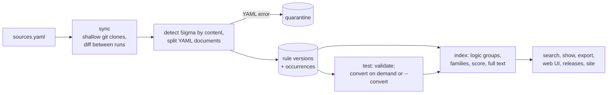

# Concepts

This page explains the words sigharvest uses: what a "rule" is, how copies are grouped and what the score means.

## From repositories to rules



- A **source** is one repository, archive, local folder, HTTPS file/page list or Hugging Face dataset listed in
  `sources.yaml`. See [non-git sources](non-git-sources.md).
- A **document** is one YAML document in a file. A file can hold several (correlations, legacy Sigma collections).
- Sigma is **recognised by content**, not by file name or path: a document is Sigma if it has `logsource` +
  `detection`, or `correlation`, or `filter` + `logsource`.
- Broken YAML goes to **quarantine** ([quarantine](quarantine.md)); nothing stops the rest of the sync.
- A **version** is one unique document content. An **occurrence** says where a version lives: source, path and
  position in the file. Nothing is deleted: when a file disappears, its occurrences are marked not present.

## Rule identity

Every document gets these keys. The exact definitions are in [identity.md](identity.md).

| key | what it is | same key means |
|---|---|---|
| `rule_id` | the rule's `id` (UUID); a UUIDv5 of the logic if missing or invalid | the same rule according to its author |
| `content_hash` | SHA-256 of the document bytes (plus inherited context for legacy collections) | identical bytes |
| `logic_hash` | SHA-256 of the canonical `logsource` + `detection` | the same detection, maybe with other metadata |
| `semantic_hash` | SHA-256 of pySigma's parsed condition tree, normalised | the same detection written differently |

The **logic hash** is the main unit: one logic hash is one "unique rule" (a **logic group**) in the index. It does
not depend on pySigma, so it works for every document. The semantic hash is looser (`|contains: x` and `*x*`
give the same one) and exists only for rules pySigma can parse.

The logic hash namespace is `sigharvest-logic-v1`. It is part of the hashed bytes and changes only when the
canonical form changes.

Rule ids are only trusted when they identify one rule. Placeholder UUIDs and ids reused by many unrelated rules
do not link anything.

## Families

A **family** is one rule and its modified copies. Logic groups are linked into a family when they share a trusted
rule id or a semantic hash, or when one rule says `related: derived` (or obsolete, merged, renamed) to another.
`related: similar` does not link. Search shows one row per family by default (`--per-logic` shows one row per
logic group). A family stays within one normalised `(product, category, service)` route.

**Near duplicates** (MinHash over detection items, Jaccard >= 0.8) are shown as "similar rules"; they never
merge families.

## Canonical copy and mirrors

The same logic is often in many repositories. The **canonical copy** is the one sigharvest shows and exports: the
copy from the source with the lowest `priority` number in `sources.yaml`, then the earliest seen. SigmaHQ has
the highest priority in the presets. A source whose logic is at least 80% contained in a bigger source is a
**mirror**; mirrors do not count as independent sources.

## Search

<!-- doctest -->
```bash
sigharvest search '"sekurlsa::logonpasswords"'                   # exact phrase
sigharvest search 'lsass -procdump' --product windows            # exclude a word, filter by log source
sigharvest search '(certutil OR bitsadmin) download level:high'  # OR, groups, inline filters
sigharvest search -- '-mimikatz NOT sekurlsa'                    # only exclusions: everything except these
sigharvest search --technique T1003 --tactic credential-access
```

- Words are prefix matches and are ANDed (words of one or two characters match exactly; `a*` is refused). `"exact phrase"`, `OR` (upper case) and parentheses work.
- `-word` or `NOT word` excludes; an exclusion applies to the whole search, including every `OR` alternative.
- `title:`, `description:`, `tags:`, `logsource:`, `fields:`, `detection:`, `author:` search one column.
- `level:`, `product:`, `category:`, `service:`, `status:`, `source:`, `tag:`, `technique:`, `tactic:`,
  `id:` (rule id or logic hash prefix), `flag:`, `validation:`, `backend:`, `datasource:`, `exclude_source:` and
  `collection:` are inline filters.
- Filters use normalised values: `T1059.001` and `attack.t1059_001` find the same rules.
- Every user term is quoted before it reaches SQLite FTS5, so search text cannot inject FTS syntax.

## Score

The quality score (0-100) ranks results that match a search equally well. It is a ranking aid, not a verdict.

| part | points | how |
|---|---|---|
| validation | 30 | ok 30, warning 18, error 0, not tested 10 |
| conversion | 25 | share of applicable backends that a pipeline maps |
| independent sources | 20 | log2 of the number of independent sources with the same logic, capped |
| status | 10 | stable 10, test 8, experimental 5, none 4, deprecated 0 |
| metadata | 10 | Enterprise ATT&CK technique 4, level 2, author 2, description 2 |
| freshness | 5 | modified within 2 years 5, within 5 years 3, else 1 |
| junk | -20 | any junk quality flag |

The exact formula is at the top of `src/sigharvest/index.py`.

## Validation and conversion

`sigharvest test` runs two stages on every new version; `update` runs **validate** only, and **convert** too with
`update --convert`. Without stored results, rule pages, `sigharvest convert` and backend exports convert on demand.
The `--backend` filter and the conversion part of the score need stored results.

- **validate**: the Sigma JSON schema (pinned commit of sigma-specification, downloaded once) plus pySigma's
  per-rule validators. Status `error` means pySigma cannot parse the detection; `warning` means schema or
  metadata issues.
- **convert**: the rule is converted for seven backends: `splunk`, `lucene` (Elasticsearch), `esql`,
  `opensearch`, `microsoft365defender` (KQL), `loki` and `sqlite`, with Sysmon/Windows pipelines where they
  apply. `ok` means a pipeline maps the fields; `raw` is syntax only (Sigma field names). A Windows rule is
  converted once per data source (Sysmon, Security 4688/4657...). A source is `partial`, without a query, when the
  rule tests a field that source's event does not carry: for Sysmon, every category is checked against the fields
  of its Sysmon events (`SYSMON_FIELDS` in `datasources.py`, Sysmon 15 schema). Field names are case-sensitive, so
  `TargetFileName` on `file_event` is missing (Sysmon writes `TargetFilename`), and so are `CommandLine` or
  `ParentImage` on `file_event`/`network_connection` (only process creation carries them) and ECS or Winlogbeat
  names (`file.path`, `winlog.event_data.Image`). The reason names the category, the Sysmon event ids and the
  missing fields. Such a query would convert, but never match Sysmon events. A field tested only in negated filters
  (`sel and not filter_*`) does not block the query: on Sysmon the filter excludes nothing, so the query stays, with
  a note that it may raise more false positives (unless the filter tests the field for null or existence, which an
  absent field inverts). Rules written for enriched agents (SigmaHQ uses `CommandLine` and `ParentImage` on
  `file_event`, `image_load` and `network_connection`) are therefore `partial` on Sysmon only when they need the field.
- **native backend**: the summary report also shows failures on the backend a rule is most likely written for:
  `microsoft365defender` when it is installed and has a pipeline for the rule's log source, otherwise `splunk`.

Results are stored per rule version and keyed by the toolchain (package versions and the code that ran), so a
new pySigma version re-tests rules automatically.

## Quality flags

Many repositories carry documents that look like Sigma but are not useful rules. The index flags them by content
(`quality.py`). Junk flags hide the document from search and export by default (`--include-junk` shows them).

| flag | what |
|---|---|
| synthetic | numbered generated series |
| foreign_query | a SIEM query (SPL, YARA-L...) wrapped in YAML |
| autogen_stub / autogen_template | generated placeholders and template families |
| test_fixture | every copy under tests/, fixtures/, examples/...; "[TEST]" titles |
| upstream_deprecated | SigmaHQ deprecated this rule id, the copy does not say so |
| template_title | unrendered templates in the title |
| match_all | every value is a bare wildcard |
| placeholder_logsource | the log source is only a placeholder (`category: generic` / `test`, an unfilled template): simulator markers, translation stubs |

Informational flags (not hidden): `ioc_list`, `converted`, `broad_logsource`, `unused_selection`,
`unused_filter`, `foreign_field_names` and logsource spelling flags. Filter with `sigharvest search --flag NAME`.
`foreign_field_names` marks a Windows rule with dotted field names (`process.command_line`, `data.Image`): they come
from one SIEM's stored schema, the Sigma Windows pipelines do not map them, and the converted query never matches
normalised events; such a rule also scores lower.

## Collections

A **collection** is a named, saved set of rules (for example "my EDR baseline"). Items are stored by logic hash
and, when the rule has a real UUID, its rule id. When a rule changes upstream (same id, new logic) the collection
follows it ("updated"); a rule removed everywhere stays listed as "missing". Collections export like searches.

## Exports and releases

Exports write the canonical copy of each selected rule plus a manifest with its sources, licence and canonical
copy. `--unit all` writes every copy instead. Correlation rules can be exported with the exact rules they
reference (`--with-dependencies`). Releases are described in [releases.md](releases.md).
