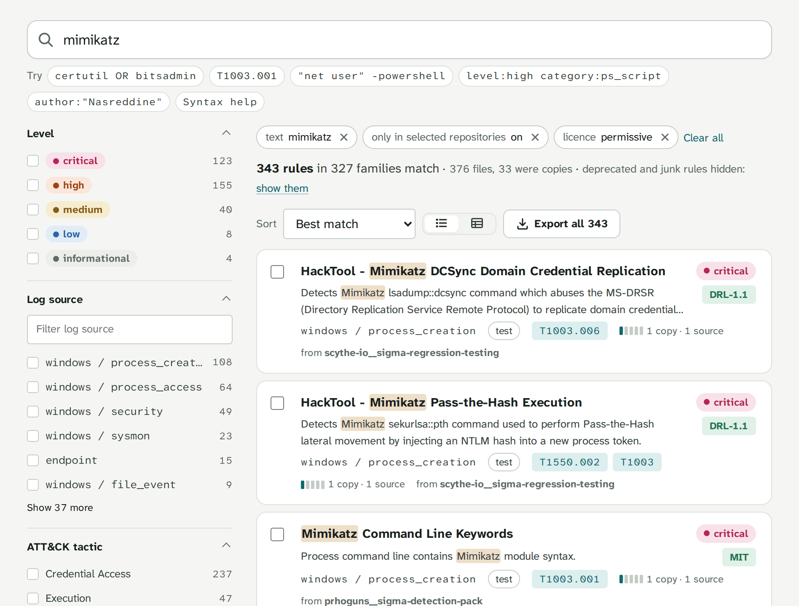
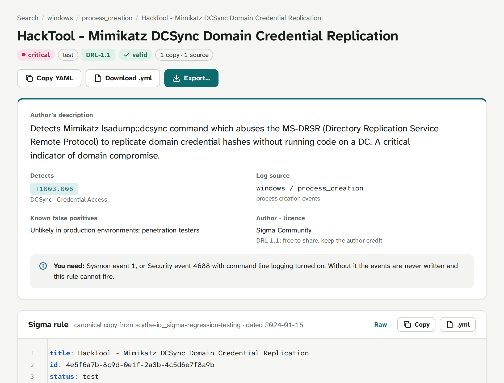
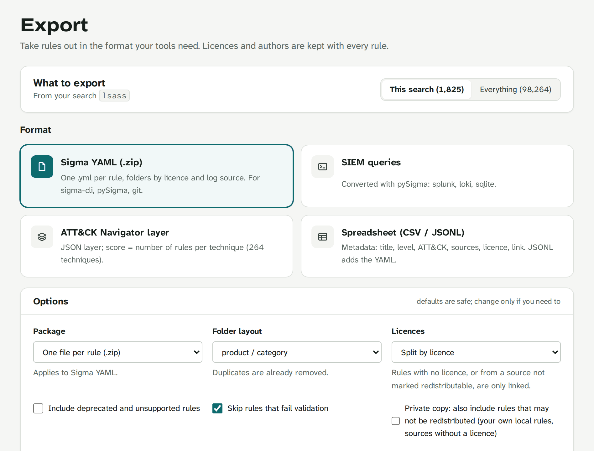
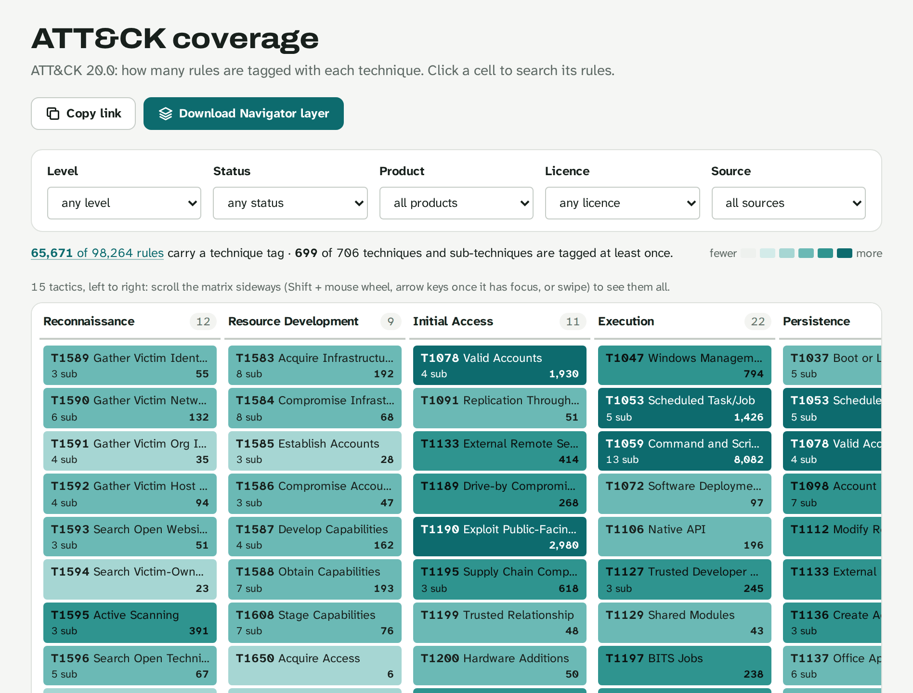
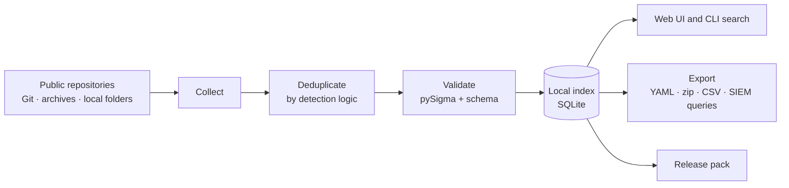

# Features

A short tour of sigharvest: what the web UI and the CLI give you, and how the pipeline gets there. To install it,
see [Getting started](getting-started.md).

## What you get

<details open>
<summary><b>Search</b>: full-text queries and filters (level, log source, ATT&CK, source, licence, validation).</summary>

<picture>
  <source media="(prefers-color-scheme: dark)" srcset="screenshots/search-dark.png">
  
</picture>

</details>

<details open>
<summary><b>Rule pages</b>: what the rule detects in plain words, the YAML, every copy and its licence.</summary>

<picture>
  <source media="(prefers-color-scheme: dark)" srcset="screenshots/rule-dark.png">
  
</picture>

</details>

<details>
<summary><b>Export</b>: Sigma YAML, SIEM queries, Navigator layer or CSV, with a <code>NOTICE.md</code> per licence.</summary>

<picture>
  <source media="(prefers-color-scheme: dark)" srcset="screenshots/export-dark.png">
  
</picture>

</details>

<details>
<summary><b>ATT&amp;CK coverage</b>: the technique matrix with rule counts per cell, filters and a Navigator layer.</summary>

<picture>
  <source media="(prefers-color-scheme: dark)" srcset="screenshots/coverage-dark.png">
  
</picture>

</details>

- **Deduplicated by logic**, not by file name: renamed copies are one rule, variants form a family.
- **Validated** with pySigma and the Sigma schema; junk and broken YAML are set aside.
- **SIEM queries** for Splunk, Loki, SQLite, Elastic, OpenSearch and Defender via pySigma. Elastic, OpenSearch and
  Microsoft 365 Defender need the `[convert-legacy]` extra ([which extra for which SIEM](export.md#which-extra-for-which-siem)).
- **ATT&CK coverage**, gaps and a Navigator layer from the rule tags.
- **Licence-aware**: every rule keeps its source, author and licence.
- **Lint your own rules** against the public corpus, with SARIF and a GitHub Action.
- **Local and private**: the web UI binds to 127.0.0.1 and loads nothing from the internet.

## In the terminal

Everything the web UI does is also a command:

<!-- doctest -->
```bash
sigharvest search mimikatz
sigharvest export lsass --product windows --format splunk --out lsass.spl
```

`init` starts with a curated set of 26 sources with original content; `sigharvest init ~/sigma --from-release latest`
starts from the full nightly corpus instead. More recipes: [CLI](cli.md).

## How it works



Updates are incremental: only changed sources are fetched, and a source that fails keeps its last good copy.
[Concepts](concepts.md) and the [rule identity specification](identity.md) explain the details.

## The nightly pack

The **sigharvest-rules** nightly pack has the whole public corpus (about 1,200 sources), deduplicated, validated and
split by licence: a permissive zip, a copyleft zip, metadata for every rule and an ATT&CK Navigator layer. The first
pack (`rules-2026-11-17`) lists 98,733 rules from 1,165 sources; 66,986 of them (permissive or copyleft) ship with
their YAML, the others as metadata and a link to the original. Rules without a licence that allows redistribution
are listed with a link only. Every file in the pack: [Releases](releases.md).

## Attribution

The published packs and site name rule authors and the GitHub owners of source repositories as their own
publications state them, for attribution. To have a rule corrected, attributed differently or removed,
[open an issue](https://github.com/threat-hunter-eu/sigharvest/issues) or write to security@threat-hunting.eu.
